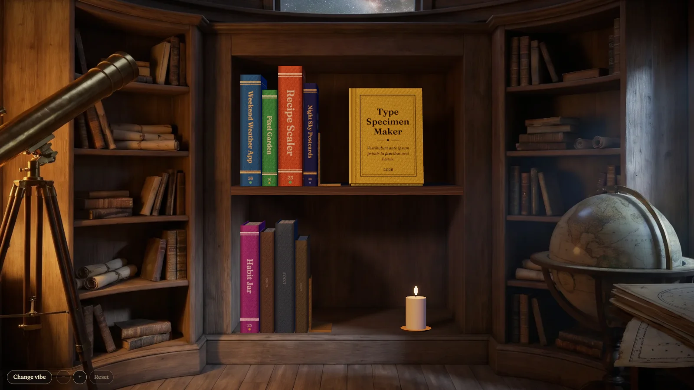
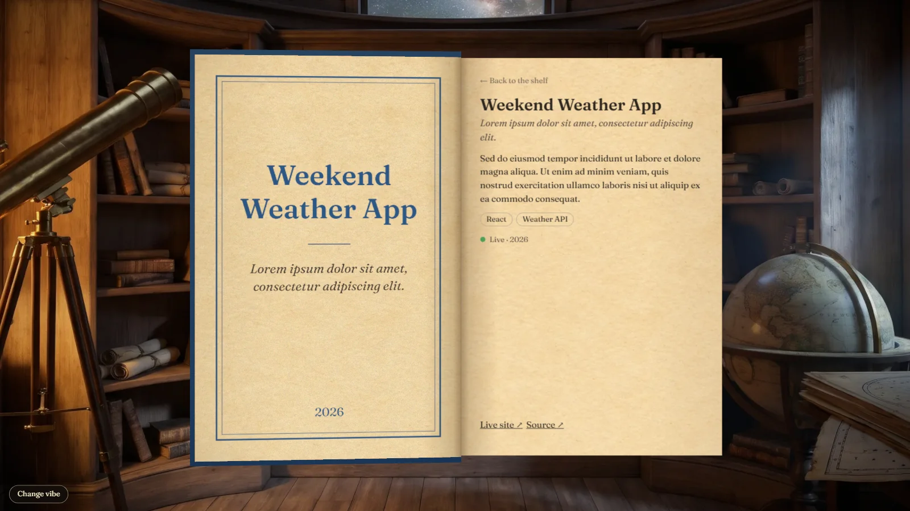

# The Shelf

An interactive 3D bookshelf in the browser where every book is a side project: pull one off the shelf and it opens to show what the project is. Fork it, swap in your own books, and deploy.

**Live demo:** https://justforfunlibrary.rekavig.com

Built with [Claude](https://claude.ai) and [Claude Code](https://claude.com/claude-code).





## Features

- **Choose your vibe.** The shelf sits inside a photographic room (Observatory, Space station, Nerdy study, Lofi attic). The 3D shelf is matched to the photo's perspective and lighting, and zooming crops the view instead of moving the camera, so the two never drift apart.
- **Books are procedural.** Each book is generated from data: color, accent, height and thickness, a cloth texture, and a spine and cover drawn on a canvas. One book can stand face-out.
- **Open a book.** Hover tilts it, click pulls it out, flies it to the camera and swings the cover open. The right page is real, selectable HTML.
- **Deep links.** Every book has its own URL (`/#weekend-weather`), and the back button closes it.
- **Zoom and pan.** Wheel or pinch, double-click or double-tap, plus on-screen buttons.
- **Mobile.** Small screens zoom in until spines are readable, then pan along the shelf. Books open as a 2D card when the 3D page would be too small.
- **Accessible.** Keyboard navigation (Tab and arrow keys), screen-reader announcements, a focusable list that mirrors the books, and `prefers-reduced-motion` support.
- **Performance.** Shadows re-render only while something moves, and quality steps down automatically on slow devices.

## Add your own books

The sample books live in [`src/data/projects.example.ts`](src/data/projects.example.ts). Replace them with your own projects.

Each book is one object; the `Project` type in [`src/data/projects.ts`](src/data/projects.ts) documents every field:

```ts
{
  id: 'weekend-weather',          // URL hash: /#weekend-weather
  title: 'Weekend Weather App',
  tagline: 'One sentence.',
  description: 'Two to four sentences, shown on the open page.',
  stack: ['React', 'Weather API'],
  year: 2026,
  status: 'live',                 // 'live' | 'wip' | 'idea'
  color: '#2f5d8a',               // cloth color
  accent: '#f2d27a',              // foil and label color
  links: [{label: 'Live site', href: 'https://…'}],
  height: 1.04,                   // 0.8–1.15
  thickness: 1.1,                 // 0.6–1.4
  faceOut: true,                  // optional: stands cover-out at the end of its row
}
```

`comingSoon` adds blank, muted books that can't be opened.

## Add your own vibe

A vibe is a 16:9 photo of a room with an empty spot for the shelf, plus one entry in [`src/data/vibes.ts`](src/data/vibes.ts).

1. Add the image as `public/vibes/<id>.webp` and a small thumbnail as `public/vibes/<id>-thumb.webp`. A straight-on, frontal view (camera parallel to the back wall) works best.
2. Copy an existing entry in `vibes.ts` and change `id`, `label` and the image paths. Pick a `mode`:
   - `alcove`: the photo already has a recess. Only the planks and books are rendered, fitted to `slot` (the front opening) and `back` (the inner back wall).
   - `standing`: a freestanding bookcase stands against a wall inside `slot`, using `vanish` as the vanishing point.
3. Calibrate the rects. Run `npm run dev`, open `/?vibe=<id>` and press **C** to outline them over the photo:
   - `1` / `2` select the slot or the second target (back wall or vanishing point)
   - Arrow keys move it; Shift + arrows move the right/bottom edge; Alt + arrows move the left/top edge
   - `[` / `]` zoom out and in; hold Ctrl for bigger steps
   - **Enter** logs the values to paste into `vibes.ts`
4. Tune `wood`, `lights`, `shadow` and `exposure` until the books look like they belong in the room.

The calibrator is dev-only and is not included in production builds.

## Local development

Requires Node.js 20.19+ or 22.12+ (for Vite 8).

```sh
npm install
npm run dev        # dev server
npm run build      # typecheck + production build into dist/
npx oxlint src     # lint
```

`?vibe=<id>` in the URL overrides the remembered vibe.

## Deploy to Firebase Hosting

```sh
npm install -g firebase-tools
firebase login
cp .firebaserc.example .firebaserc   # then set your Firebase project id
npm run build && firebase deploy --only hosting
```

`firebase.json` serves `dist/` with long-lived caching for hashed assets and images. `.firebaserc` is gitignored.

## Credits

- [three.js](https://threejs.org), [react-three-fiber](https://github.com/pmndrs/react-three-fiber), [drei](https://github.com/pmndrs/drei) and [postprocessing](https://github.com/pmndrs/postprocessing)
- [Fraunces](https://github.com/undercasetype/Fraunces) typeface by Undercase Type, licensed under the SIL Open Font License 1.1, self-hosted via [Fontsource](https://fontsource.org)
- Inspired by an Instagram reel by @marina_uiux.

## License

- **Code:** [MIT License](LICENSE), © 2026 Réka Víg.
- **Images** in `public/vibes/` and `public/textures/`: AI-generated with Higgsfield and **not** covered by the MIT License. You may use them freely as part of this template or projects built from it, but you may not use them to train, fine-tune or otherwise improve any AI/ML model. See [`public/ASSETS_LICENSE.md`](public/ASSETS_LICENSE.md).
